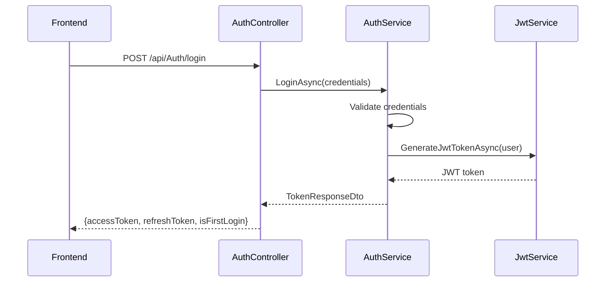
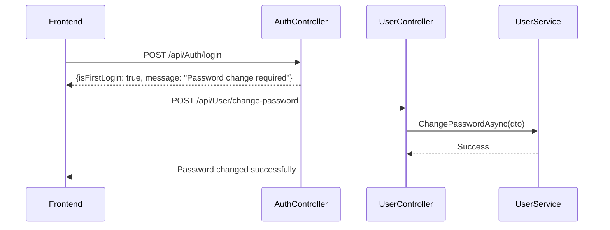
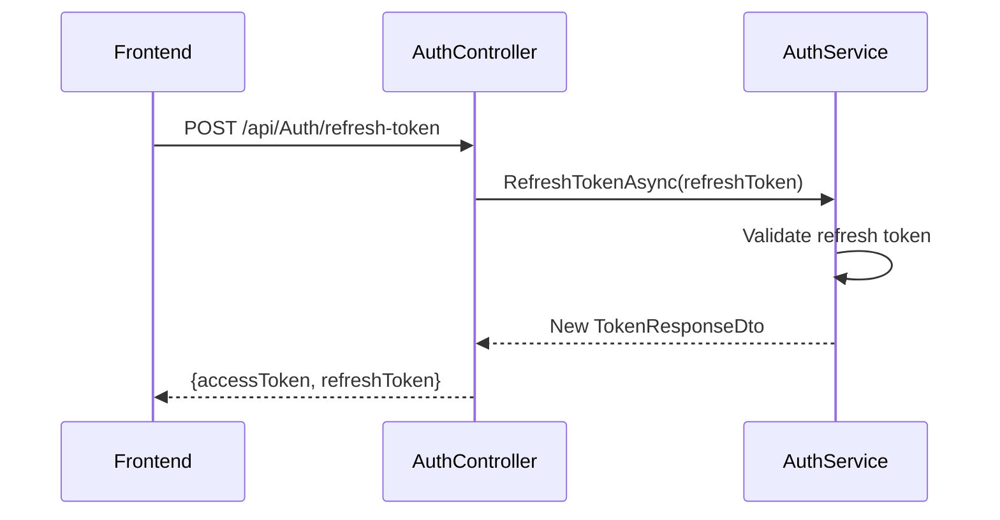

# Frontend Authentication Integration Guide

## Overview

Your backend supports **three authentication methods**:
1. **Standard JWT Authentication** (Primary)
2. **Active Directory (AD) Authentication** 
3. **Cookie-based Authentication** (For web clients)

## Core Entities & Data Structures

### ApplicationUser Entity
```typescript
interface ApplicationUser {
  id: string;                    // GUID
  userName: string;              // Login username
  email: string;                 // Email address
  fullName: string;              // Display name
  employeeId: string;            // Company employee ID
  department: string;            // Department name
  title: string;                 // Job title
  manager?: string;              // Manager name
  company: string;               // Company name
  phoneNumber?: string;          // Phone number
  
  // Status fields
  isFirstLogin: boolean;         // true = needs password change
  status: "Active" | "Inactive"; // Account status
  lastLogin?: Date;              // Last login timestamp
  lastPasswordChange?: Date;     // Last password change
  
  // Audit fields
  createdDate: Date;
  updatedDate?: Date;
  createdBy?: string;
  updatedBy?: string;
  isArchived: boolean;
  archiveDate?: Date;
}
```

### User Roles & Hierarchy
```typescript
enum SystemRoles {
  Admin = "Admin",           // Highest level - full access
  President = "President",   // Executive level
  VicePresident = "Vice-President",
  Director = "Director",     // Management level
  Manager = "Manager",
  Supervisor = "Supervisor",
  Member = "Member"          // Basic user level
}

// Role hierarchy (for permission checking)
const RoleRank = {
  "Admin": 99,
  "President": 6,
  "Vice-President": 5,
  "Director": 4,
  "Manager": 3,
  "Supervisor": 2,
  "Member": 1
};
```

## Authentication Endpoints

### 1. Standard JWT Authentication

#### Login
```http
POST /api/Auth/login
Content-Type: application/json

{
  "username": "string",
  "password": "string"
}
```

**Success Response (200):**
```json
{
  "accessToken": "eyJhbGciOiJIUzI1NiIsInR5cCI6IkpXVCJ9...",
  "refreshToken": "guid-string",
  "isFirstLogin": false
}
```

**First Login Response (200):**
```json
{
  "message": "First login. Password change required.",
  "accessToken": "eyJhbGciOiJIUzI1NiIsInR5cCI6IkpXVCJ9...",
  "refreshToken": "guid-string",
  "isFirstLogin": true
}
```

**Error Response (401):**
```json
{
  "message": "Invalid credentials."
}
```

#### Refresh Token
```http
POST /api/Auth/refresh-token
Content-Type: application/json

{
  "token": "refresh-token-guid"
}
```

**Success Response (200):**
```json
{
  "accessToken": "new-jwt-token",
  "refreshToken": "new-refresh-token",
  "isFirstLogin": false
}
```

#### Logout
```http
POST /api/Auth/logout
Authorization: Bearer <access-token>
```

**Success Response (200):**
```json
{
  "message": "Logged out successfully."
}
```

### 2. Active Directory Authentication

#### AD Login
```http
POST /api/ADAuth/login
Content-Type: application/json

{
  "username": "ad-username",
  "password": "ad-password"
}
```

**Success Response (200):**
```json
{
  "token": "jwt-token",
  "user": {
    "id": "user-guid",
    "fullName": "User Name",
    "email": "user@company.com"
  }
}
```

### 3. Cookie Authentication (Web Clients)

#### Cookie Login
```http
POST /api/Auth/cookie-login
Content-Type: application/json

{
  "username": "string",
  "password": "string"
}
```

**Success Response (200):**
```json
{
  "message": "Signed in with cookie.",
  "user": {
    "userName": "username",
    "email": "user@company.com"
  }
}
```

#### Cookie Logout
```http
POST /api/Auth/cookie-logout
Authorization: Bearer <token>
```

## JWT Token Structure

### Claims in JWT Token
```typescript
interface JWTClaims {
  // Standard claims
  sub: string;           // User ID
  name: string;          // Username
  email: string;         // User email
  
  // Custom claims
  Department: string;    // User's department
  role: string[];        // User roles array
  
  // Standard JWT claims
  iss: string;           // Issuer
  aud: string;           // Audience
  exp: number;           // Expiration timestamp
  iat: number;           // Issued at timestamp
}
```

### Token Usage
- **Access Token**: Include in `Authorization: Bearer <token>` header for API calls
- **Refresh Token**: Store securely (httpOnly cookie recommended) and use to refresh access tokens
- **Token Expiry**: Access tokens expire based on configuration (check JWT settings)

## Authentication Flows

### 1. Standard Login Flow


### 2. First Login Flow


### 3. Token Refresh Flow


## User Registration

### Admin User Creation
```http
POST /api/Auth/register
Authorization: Bearer <admin-token>
Content-Type: application/json

{
  "fullName": "John Doe",
  "username": "johndoe",
  "email": "john@company.com",
  "password": "securePassword",
  "role": "Member",
  "department": "IT",
  "employeeId": "EMP001",
  "title": "Software Developer",
  "manager": "Jane Smith",
  "company": "Company Name",
  "phoneNumber": "+1234567890"
}
```

### Admin User Creation (with AD lookup)
```http
POST /api/Admin/create-user
Authorization: Bearer <admin-token>
Content-Type: application/json

{
  "employeeId": "EMP001"
}
```

## Password Management

### Change Password (for first login)
```http
POST /api/User/change-password
Authorization: Bearer <token>
Content-Type: application/json

{
  "username": "username",
  "currentPassword": "oldPassword",
  "newPassword": "newPassword"
}
```

## Error Handling

### Common HTTP Status Codes
- **200**: Success
- **400**: Bad Request (validation errors)
- **401**: Unauthorized (invalid credentials, expired token)
- **403**: Forbidden (insufficient permissions)
- **404**: Not Found
- **500**: Internal Server Error

### Error Response Format
```json
{
  "message": "Error description",
  "errors": ["Detailed error 1", "Detailed error 2"]  // Optional array
}
```

## Frontend Implementation Guidelines

### 1. Token Storage
```typescript
// Recommended: Store refresh token in httpOnly cookie
// Store access token in memory or secure storage
class AuthService {
  private accessToken: string | null = null;
  
  async login(credentials: LoginRequest): Promise<TokenResponse> {
    const response = await fetch('/api/Auth/login', {
      method: 'POST',
      headers: { 'Content-Type': 'application/json' },
      body: JSON.stringify(credentials)
    });
    
    if (response.ok) {
      const data = await response.json();
      this.accessToken = data.accessToken;
      // Store refresh token in httpOnly cookie via backend
      return data;
    }
    throw new Error('Login failed');
  }
}
```

### 2. Token Refresh Strategy
```typescript
class ApiClient {
  async request(url: string, options: RequestInit = {}) {
    // Add auth header
    if (this.accessToken) {
      options.headers = {
        ...options.headers,
        'Authorization': `Bearer ${this.accessToken}`
      };
    }
    
    let response = await fetch(url, options);
    
    // Handle token expiry
    if (response.status === 401) {
      const refreshed = await this.refreshToken();
      if (refreshed) {
        // Retry original request
        options.headers = {
          ...options.headers,
          'Authorization': `Bearer ${this.accessToken}`
        };
        response = await fetch(url, options);
      }
    }
    
    return response;
  }
}
```

### 3. First Login Handling
```typescript
interface LoginResponse {
  accessToken: string;
  refreshToken: string;
  isFirstLogin: boolean;
  message?: string;
}

async handleLogin(credentials: LoginRequest) {
  const response = await this.authService.login(credentials);
  
  if (response.isFirstLogin) {
    // Redirect to password change page
    this.router.navigate('/change-password');
    // Show message: response.message
  } else {
    // Normal login flow
    this.router.navigate('/dashboard');
  }
}
```

### 4. Role-Based Access Control
```typescript
class RoleService {
  getUserRoles(): string[] {
    const token = this.parseJWT(this.accessToken);
    return token.role || [];
  }
  
  hasRole(role: string): boolean {
    return this.getUserRoles().includes(role);
  }
  
  hasAnyRole(roles: string[]): boolean {
    return roles.some(role => this.hasRole(role));
  }
  
  canAccessResource(userRoles: string[], requiredRole: string): boolean {
    // Implement role hierarchy logic
    const roleRank = {
      'Admin': 99,
      'President': 6,
      'Vice-President': 5,
      'Director': 4,
      'Manager': 3,
      'Supervisor': 2,
      'Member': 1
    };
    
    const userMaxRank = Math.max(...userRoles.map(r => roleRank[r] || 0));
    const requiredRank = roleRank[requiredRole] || 0;
    
    return userMaxRank >= requiredRank;
  }
}
```

## Security Considerations

1. **Token Storage**: Never store tokens in localStorage for production
2. **HTTPS Only**: Always use HTTPS in production
3. **Token Expiry**: Implement automatic token refresh
4. **Logout**: Clear all tokens and redirect to login
5. **XSS Protection**: Sanitize user inputs
6. **CSRF Protection**: Use appropriate CSRF tokens for cookie auth

## Testing Endpoints

### Test Login Credentials
- Default admin password: `Welcome2cbe` (for first-time setup)
- Check with your backend team for test user credentials

### Session Demo (Cookie Auth)
```http
GET /api/Auth/session-demo
Authorization: Bearer <token>
```

## Configuration

### JWT Settings (Backend)
The backend uses these JWT settings (check with backend team for exact values):
- Secret Key: Configured in appsettings.json
- Issuer: Your application name
- Audience: Your frontend application
- Expiration: Configurable (typically 15-60 minutes for access tokens)

---

This guide should provide your frontend team with everything they need to integrate with your authentication system. For any specific implementation details or clarifications, coordinate with your backend team.
